# PyStarLight 

**Occultation light curves from start to finish:** record GPS-timed video at the telescope,
check it, measure the stars and time the event. You pick the target and the reference stars;
the rest of the analysis runs on its own, up to the disappearance and reappearance times. The
light curve also opens directly in [PyOTE](https://github.com/bob-anderson-ok/py-ote), for the
classic, more hands-on analysis.

PyStarLight is a Python library with one command on top of it, `pystarlight`, and three
programs behind it:

- **`pystarlight analyze`, the analysis.** It opens a recording in any common format and
  plate-solves the field (online or offline). It finds the target by name (Gaia DR3, UCAC4,
  TYC, SIMBAD), even when the star is too faint to see. You mark target, reference and check
  stars and press Run. The tracking follows wind-shake, drift and field rotation, with the
  target interpolated through the event. The output is:
  - a light curve in PyMovie's CSV layout, ready for PyOTE;
  - summary figures in flux and catalogue magnitudes;
  - an **automatic step fit** that gives each disappearance and reappearance time, with a
    1 sigma error;
  - magnitude histograms;
  - an `event.json` with every detail of the event.
- **`pystarlight camera`, capture on a Raspberry Pi 5 (experimental).** It records frames
  GPS-triggered and stamped in UTC (VEYE MIPI and Aravis cameras, u-blox GPS) to RAVF or SER;
  ZWO ASI cameras and any `/dev/video` device (e.g. an analog grabber) free-run with the
  computer's time stamps. It has a live stack and plate solve. Every recording carries the station and equipment data and the GPS position.
  Tonight's events can be loaded from a [PySyzygos](https://github.com/pyzahl/PySyzygos)
  favorites server: target star, asteroid and the recording window are filled in for you.
- **`pystarlight player`, a player that knows about time.** Unlike a normal video player it
  shows each frame's UTC and GPS status, checks the time stamps (dropped, duplicated and
  irregular frames), and stacks and plate-solves a frame range.

The processing is derived from [PyMovie](https://github.com/bob-anderson-ok/pymovie) 4.2.8 by
Bob Anderson. There are two analysis modes:

- **PyMovie mode** (`analyze()`) reproduces PyMovie's numbers bit for bit, and the tests run
  PyMovie's own code to check this;
- **global mode** (`analyze_global()`, the viewer's default) is new. It uses peak fits, one
  weighted rigid transform for all stars, interpolates the target through the event, and
  measures with Naylor's optimal extraction or sub-pixel circular apertures. On a faint star it
  gives about a quarter of PyMovie's normalised scatter (23.5 % → 6.4 % on a 94 s ASTRID
  recording).

Supported recordings: RAVF (ASTRID), SER, ADV/AAV, AVI/MOV, FITS folders. Timestamps come from
the file or are read from a VTI overlay. MIT licence.

## Contents

- [Install](#install)
  - [1. Prerequisites (once)](#1-prerequisites-once)
  - [2. Install uv](#2-install-uv)
  - [3. Get PyStarLight](#3-get-pystarlight)
  - [4. Check it](#4-check-it)
  - [Extras](#extras)
- [The tools](#the-tools)
- [Getting started](#getting-started)
  - [1. Configure (once)](#1-configure-once)
  - [2. Mark the stars](#2-mark-the-stars)
  - [Fully automatic (`--auto`)](#fully-automatic-auto)
  - [3. Run](#3-run)
  - [Event timing: the automatic step fit](#event-timing-the-automatic-step-fit)
  - [4. Open in PyOTE](#4-open-in-pyote)
  - [Same thing from Python](#same-thing-from-python)
- [Example](#example)
  - [Analog video with a VTI](#analog-video-with-a-vti)
  - [Dark / flat calibration](#dark--flat-calibration)
  - [Figures](#figures)
  - [Locate the target](#locate-the-target)
- [Package layout](#package-layout)
- [Things to know](#things-to-know)
- [References](#references)
- [Licence](#licence)

## Install

PyStarLight runs on Linux, macOS and Windows with Python 3.10 or newer. The capture program
(`pystarlight camera`) is for a Raspberry Pi 5: see [CAPTURE.md](CAPTURE.md). The steps below
install the analysis (`pystarlight analyze`) and the player (`pystarlight player`).

**The one thing people miss: the viewer needs Tk** (Python's `tkinter`) for its window and file
dialog. Most Linux distributions ship it as a separate package, so install it first (step 1).
Without it the viewer stops at start and says what to install. **The player needs Qt**
(PySide6 or PyQt5), which the viewer does not: `--extra camera` in step 3 brings PySide6 on
every system. Without Qt the player stops at start and says what to install.

### 1. Prerequisites (once)

**Linux**

```bash
sudo apt install git python3 python3-venv python3-tk      # Debian, Ubuntu, Raspberry Pi OS, Mint
sudo dnf install git python3 python3-tkinter              # Fedora
sudo pacman -S git python tk                              # Arch, Manjaro
```

Qt for the player comes from step 3 (`--extra camera`, PySide6 wheels). The distribution's
PyQt5 (`sudo apt install python3-pyqt5`, `dnf install python3-qt5`, `pacman -S python-pyqt5`)
serves only the system Python, not the uv / venv environment; it is what the Raspberry Pi's
capture setup uses ([CAPTURE.md](CAPTURE.md)).

Highly recommended: Install astrometry package and small mas index data. Configure it.

**macOS**

- Python from [python.org](https://www.python.org/downloads/macos/) includes Tk; nothing else
  is needed. With Homebrew's Python, add Tk: `brew install python-tk` (for the same version as
  `python3 --version`, e.g. `brew install python-tk@3.12`).
- git: `xcode-select --install` (the command line tools).
- Apple Silicon (M1 and later): the ADV/AAV reader's wheel (`Adv2`) ships an Intel-only
  library. Build it once after step 3 with `sh scripts/build_advcore.sh`, and again whenever
  Adv2 is reinstalled.
- Qt for the player: nothing to do beforehand, `--extra camera` in step 3 installs PySide6
  (Intel and Apple Silicon). Not Homebrew's `pyqt@5`: it belongs to Homebrew's Python only.
- Highly recommended: Install brew + astrometry + astrometry data (https://data.astrometry.net/4200/)
  '''
   Brew: $/bin/bash -c "$(curl -fsSL https://raw.githubusercontent.com/Homebrew/install/HEAD/install.sh)"
   Astrometry: $brew install astrometry-net
   Astrometry data default path OSX: $mkdir /opt/homebrew/Cellar/astrometry-net/0.97_1/data
   (see data path set in /opt/homebrew/etc/astrometry.cfg)
   Astrometry data, go to folder just created and $curl -O "http://astrometry.net[00-47].fits"
 '''
 
**Windows**

- Python from [python.org](https://www.python.org/downloads/windows/): in the installer, keep
  **"tcl/tk and IDLE"** ticked (it is by default) and tick **"Add python.exe to PATH"**.
- git from [git-scm.com](https://git-scm.com/download/win).
- The commands below run in PowerShell.
- Qt for the player: nothing to do beforehand, `--extra camera` in step 3 installs PySide6.

**Or let uv bring its own Python**, on any of the three: uv's Python builds include Tk. uv
otherwise takes the system's Python when it finds one (on Linux usually without Tk). Add
`--python-preference only-managed` to `uv sync` in step 3. An environment already built on the
system's Python is not switched by that (nor by `uv python install`): rebuild it, in the
PyStarLight folder, with `rm -rf .venv && uv sync --python-preference only-managed --extra all`.
When Tk is missing, the viewer says which Python it runs on and which of the two fixes applies.

### 2. Install uv

[uv](https://docs.astral.sh/uv/) sets up the environment and runs the programs.

```bash
curl -LsSf https://astral.sh/uv/install.sh | sh            # Linux, macOS
```
```powershell
powershell -ExecutionPolicy ByPass -c "irm https://astral.sh/uv/install.ps1 | iex"   # Windows
```

Open a new terminal afterwards, so that `uv` is found.

### 3. Get PyStarLight

```bash
git clone https://github.com/pyzahl/PyStarLight.git
cd PyStarLight
uv sync --extra all --extra camera      # viewer: plots, RAVF + ADV/AAV readers, SIMBAD; player: Qt
uv run pystarlight                      # analyze: opens a file dialog, pick a recording
uv run pystarlight player               # the player, also with a file dialog
```

Only the viewer wanted? `uv sync --extra all` is enough; the player then says what is missing.
Note that each `uv sync` installs exactly the extras it names and removes the others, so keep
`--extra camera` on later syncs.

> **After every update** (`git pull`, in the `PyStarLight` folder) run the same `uv sync` with
> your extras again, e.g. `uv sync --extra all --extra camera --extra aravis` on the Pi. `uv run`
> alone installs only the base packages: new dependencies of an extra stay missing, and when the
> Python version changed (`.python-version`) it rebuilds `.venv` without any extras, so the
> camera stops with `No module named 'serial'` (or `PySide6`, `gi`) until you sync.

uv uses Python 3.12 (`.python-version`; it downloads it if needed), whatever else is installed: a
brand-new Python (3.15 in 2026-11) has no ready-made wheels of scikit-image and friends yet, so they
would be compiled, which needs a C/C++ compiler. A `.venv` made earlier with another Python: delete it
(`rm -rf .venv`) and run `uv sync` again.

Without uv, plain pip works in a virtual environment (Python 3.10+, with Tk as in step 1):

```bash
python3 -m venv .venv && . .venv/bin/activate              # Windows: .venv\Scripts\activate
pip install -e ".[all,camera]"                             # in the cloned folder
pip install "starlight-photometry[all,camera] @ git+https://github.com/pyzahl/PyStarLight"   # or without a clone
pystarlight
```

(Not on PyPI yet; the distribution name will be `starlight-photometry`, import name `pystarlight`.)

### 4. Check it

```bash
uv run python -c "import tkinter; print('Tk', tkinter.TkVersion)"    # the viewer's window
uv run python -c "from pystarlight.capture import qt; print(qt.API)"  # the player's Qt
uv run pystarlight config path                                       # the config file in use
```

If the first line fails, go back to step 1 (Linux: `python3-tk`; macOS Homebrew: `python-tk`).
If the second says `No module named 'PyQt5'`, the environment has no Qt: run `uv sync --extra
all --extra camera` (or, with pip in the venv, `pip install PySide6-Essentials` or
`pip install PyQt5`). Either binding works; `PYSTARLIGHT_QT=pyqt5` picks PyQt5 when both are there.

### Extras

| extra | adds | for |
|---|---|---|
| `all` | `plot`, `ravf`, `adv`, `catalog` | the viewer: use this |
| `plot` | matplotlib | the viewer and the figures |
| `ravf` | RAVF reader | ASTRID / PyStarLight capture recordings |
| `adv` | Adv2 | ADV / AAV recordings (DVTI, OccuRec) |
| `catalog` | astroquery | star names from SIMBAD and the VO (offline: PySyzygos' Gaia extract) |
| `camera` | PySide6, pyserial, astroquery | the player (`pystarlight player`, any OS) and the capture program |
| `aravis` | PyGObject | GenICam (USB3 / GigE) cameras in the capture program: Linux / Pi only, see [CAPTURE.md](CAPTURE.md) |

Optional, outside Python: **offline plate solving** with a local astrometry.net
(Linux / macOS, [below](#optional-offline-plate-solving-local-astrometrynet)); on Windows the
viewer uses nova.astrometry.net (needs a free API key).

For development: `uv sync --group dev --extra all`, then `uv run pytest` and `uvx ruff check`.

## The tools

One command, `pystarlight`, started with `uv run` from the clone (after `uv sync` with the
extras shown); `pystarlight --help` lists the tools, `pystarlight <tool> --help` their options:

| command | what | install, start |
|---|---|---|
| `pystarlight analyze FILE` | the analysis: mark target / reference / check stars, plate-solve, photometry, event timing, `event.json`, export for PyOTE (see [Getting started](#getting-started)) | `uv sync --extra all`<br>`uv run pystarlight analyze FILE` |
| `pystarlight player FILE` | play a recording with its time: UTC and GPS status per frame, dropped / irregular frames, stack & plate-solve a frame range | `uv sync --extra all --extra camera`<br>`uv run pystarlight player FILE` |
| `pystarlight camera` | capture on the Raspberry Pi 5: live view, GPS-timed RAVF / SER recording, live stack + plate solve | `uv sync --extra all --extra camera --extra aravis`<br>`uv run pystarlight camera` |
| `pystarlight config` | the private config: `init`, `path`, `show`, `sites` | `uv run pystarlight config path` |

`FILE` is any supported recording (`.ravf .ser .adv .aav .avi .mov` or a FITS folder).

- `pystarlight FILE` (a file instead of a tool) analyses it; plain `pystarlight`, and
  `pystarlight player` without a file, open a file dialog.
- `analyse` works as well as `analyze`; `python -m pystarlight` as well as `pystarlight`
  (Windows without the scripts folder on PATH).
- The earlier names stay as commands of their own: `pystarlight-view` (= analyze),
  `pystarlight-player` (and `pystarlight-review`, its name before), `pystarlight-camera`,
  `pystarlight-config`.

The camera and the [player](CAPTURE.md#player) are described in [CAPTURE.md](CAPTURE.md).

## Getting started

### 1. Configure (once)

After the [installation](#install):

```bash
cd PyStarLight
uv run pystarlight config init --here    # private config: ./pystarlight.toml (git-ignored)
```

Edit the config. The file is only readable by you and is never part of the repository.

- **`[observer]`**: your name, email, station and equipment (aperture and focal length in mm).
  On the Pi these are best set in the camera's **Station & equipment** dialog; every recording
  then carries them, including the effective focal length that gives the plate-scale hint.
- **`[fallback_equipment]`**: focal length and pixel size for videos that do not carry their
  optics (other programs' ADV / AVI, a SER without its sidecar, older recordings). Used with a
  warning each time.
- **`[astrometry] api_key`**: your nova.astrometry.net API key, for online plate solving.
- **`pysyzygos_sites`**: PySyzygos' `sites.py` (read as data, never executed). It gives the
  station dialog's first-time defaults and the folder of the local Gaia catalogue.
- `[pysyzygos_observations]` (PySyzygos on another computer, [below](#3-run)) and `[camera]`
  (the Pi camera's recording window, [CAPTURE.md](CAPTURE.md)): only when needed.
- All analysis settings and the aperture roles (names, colours, keys) live there too.

`pystarlight config show` prints it with secrets masked, `pystarlight config sites` lists
PySyzygos' sites, `pystarlight config path` shows which file is used (lookup:
`$PYSTARLIGHT_CONFIG`, `./pystarlight.toml`, the project root's `pystarlight.toml`,
`~/.config/pystarlight/config.toml`).

**Dark / flat ("bright") clips**: set `[calibration] dark` and `flat` (and `flat_dark` if the
flat's exposure differs) to clip files. Each clip is averaged into a master frame (mean, or
median), cached in `~/.cache/pystarlight` and re-stacked only when the clip changes, then applied
to every aperture box. Record them with the same gain and exposure as the observation.

#### Optional: offline plate solving (local astrometry.net)

With `solve-field` and index files installed, the viewer solves every recording offline as soon
as it opens (a few seconds with the plate-scale hint); without them it uploads to
nova.astrometry.net on `p`. `[astrometry] solver = "auto"` (default) picks local when it finds
`solve-field` and at least one index file; `"local"` or `"nova"` force one.

1. **Install the solver.** Debian / Ubuntu / Raspberry Pi OS:
   `sudo apt-get install astrometry.net`. macOS (Homebrew): `brew install astrometry-net` (check
   the name with `brew search astrometry`).
2. **Install index files for your field size.** Each index set holds star quads of one size, and
   the solver needs quads of about **¼ to 1× the field width** (it copes down to about 1/10). Work out the
   field width: pixels × plate scale (″/px = 206.265 × pixel µm / focal mm). Debian packages:

   | package | quad size | fields of about | size |
   |---|---|---|---|
   | `astrometry-data-2mass-00` / `-01` | 2′–2.8′ / 2.8′–4′ | **2′–16′: small fields** (long focal length, small ROI) | 14 / 9 GB |
   | `astrometry-data-2mass-02` / `-03` | 4′–5.6′ / 5.6′–8′ | 4′–30′ | |
   | `astrometry-data-2mass-04` … `-07` | 8′–30′ | 8′–2° | |
   | `astrometry-data-2mass-08-19` | 30′–2000′ | 30′ and wider (camera lenses) | |

   Small fields need the small-quad sets (the large downloads); with only wide-quad sets they never solve. Example:
   ASTRID (IMX296, 1456 px) at 343 mm, 2.07″/px: 50′ × 38′ field, quads 12′–50′:
   `-05` … `-07` and `-08-19`. A 1280 px ROI at 2000 mm (0.35″/px, 7.5′): `-00` … `-03`. The packages fetch the files
   at install time into `/usr/share/astrometry` (listed by `add_path` in `/etc/astrometry.cfg`).

   Elsewhere (macOS): download the `index-42xx*.fits` files you need from
   <http://data.astrometry.net/4200/> into a folder and add `add_path /that/folder` to the
   `astrometry.cfg` next to `solve-field` (Homebrew: `$(brew --prefix)/etc/astrometry.cfg`).
   PyStarLight reads that file to see which index files exist.
3. **Give the scale.** It comes from the recording's own optics (focal length and sensor, as
   PyStarLight's camera writes them), else from `[fallback_equipment]` with a warning, or set
   `[astrometry] scale_arcsec`. With the scale known a solve takes seconds, blind it can take
   minutes.
   Small fields show few stars: more stacked frames help (`[astrometry] stack_frames`, default
   16), and an ADV file's own RA/Dec is used as the field centre.
4. **Check:** the viewer's key list says `p plate-solve (offline)` when the local solver is found.

Measured times and the owner's Raspberry Pi setup: [CAPTURE.md, Offline plate
solving](CAPTURE.md#offline-plate-solving-local-astrometrynet).

#### Optional: star names offline (PySyzygos' Gaia catalogue)

Stars are named from **PySyzygos'** local Gaia DR3 catalogue when it is on the machine: Tycho-2
or UCAC4 name (as Occult and OWC show them), Gaia DR3 id and G magnitude, offline and in about a
millisecond per star. Without it, names come from SIMBAD (online).

- It needs a **format-2** catalogue with its **`xref`** part (the UCAC4 / Tycho-2 / Hipparcos
  numbers): in PySyzygos, `pysyzygos catalog fetch --dir gaia_dr3_g16 --groups quality,xref`
  (ready-made G ≤ 16 from Zenodo: 78 M stars, core 2.4 GB), or `pysyzygos catalog add xref` /
  `pysyzygos catalog xref` for an existing one. Without `xref` the stars get their Gaia DR3 id.
- **Where it is found:** `[catalog] gaia_dir` in the config, else `$PYSYZYGOS_CATALOG`, else a
  format-2 catalogue folder next to the `sites.py` that `pysyzygos_sites` points to (one with
  `xref` first). Older-format folders (`gaia_dr3_g18` from before PySyzygos 1.3) are skipped.
- It is read with numpy only (memory-mapped); no PySyzygos code is imported or run.
- Gaia leaves out the very brightest stars (G < ~3) and the catalogue stops at its G limit:
  those come from astrometry.net's names (Deneb, ...) or SIMBAD.

### 2. Mark the stars

```bash
uv run pystarlight analyze path/to/recording.ravf     # or just: uv run pystarlight FILE
uv run pystarlight                                    # no file: a file dialog
```

**Open** (or ctrl+o) loads another recording in a new window with the same settings; the
apertures of the current one are not saved on the way (`s` saves them).

The field is **plate-solved** from a median stack of the first frames. With a
[local astrometry.net](#optional-offline-plate-solving-local-astrometrynet) this happens offline
as soon as the movie opens; otherwise press `p` to upload it to nova.astrometry.net in the
background (private upload; nothing is uploaded without `p` or [`--auto`](#fully-automatic-auto)). The result is cached as
`<movie>.wcs.fit` and loaded when the movie is opened again. Burnt-in timestamp rows are blanked
first. Hints: the recording's own RA/Dec (ADV) as the field centre, and the plate scale from the
recording's optics, else `[fallback_equipment]` (not for a recording made more than 20 km from
your `[observer]` station: someone else's optics). **Esc** stops a running solve or star
identification (e.g. without network); **Run** never waits for star names. Once solved, the
cursor readout shows RA/Dec, an N/E compass is drawn, and the line below the status gives the
plate scale, the direction of north and whether the image is mirrored.

The **three brightest stars** are then found in the stack (outside a burnt-in timestamp) and
named: a proper name from astrometry.net where it has one (Deneb, ...); otherwise, **offline**,
from [PySyzygos' local Gaia DR3 catalogue](#optional-star-names-offline-pysyzygos-gaia-catalogue)
when it is on the machine (Tycho-2 or UCAC4 name, Gaia DR3 id, G magnitude, proper motion
applied). Stars it does not have are looked up in SIMBAD online (HD, HIP, TYC, Gaia DR3 IDs, V;
needs the `catalog` extra; a lookup gives up after 20 s and SIMBAD is then skipped for 5
minutes). They are labelled on the image and cached as `<movie>.stars.json`. The stars in your
**target, reference and check apertures** are identified the same way (automatically after the solve and
before each run, `i` to repeat): position refined by a peak fit on the solved frames (the field
drift since then is measured and removed), then name, IDs and V. The results are saved in
`apertures.json`, shown on the aperture labels and zoom views, and written to both CSVs. The zoom views show RA/Dec and,
for those stars, the name. Both CSVs carry the pixel → RA/Dec mapping (scale, north angle,
mirroring, CRVAL/CRPIX/CD), the named stars, and every aperture's RA/Dec; `apertures.json` keeps
RA/Dec too.

**Gaia astrometry check** (with the local catalogue): along with the identification the frame
shown (`i` repeats it on the current frame; the plate solution is moved by the measured drift) is
reduced against Gaia DR3 in the manner of PRAIA ([Assafin et al. 2011](#references)): the measured stars are
paired with Gaia (proper motions to the observation date), a tangent-plane polynomial (4
constants up to 3rd order, as the star count allows) relates them, and outliers are dropped one by
one. All matched stars and the apertures are then **measured** (circle of 2 x the median FWHM,
background from an annulus) and put on the Gaia G scale (zero point from the median of G minus
instrumental, outliers clipped). The line below the status then reads e.g. `frame 200: Gaia O-C
0.63"/0.61" (25 stars), mag scatter 0.25 (24); target 0.84" (0.9 sigma) mag 10.06+-0.06 (G 9.89,
+0.17 = 0.7 sigma of 0.25)`: the residuals of the reference stars, how far the target sits from
its Gaia star, its magnitude, and its difference from G in units of the field's scatter.
**On every frame you step to** (not while playing) all those stars and apertures are measured
again where they are now (field drift by phase correlation; the tracked centres after a run), with
a new zero point (clouds): the aperture labels show `m=` next to the catalogue `G=`, the target's
with error, difference from G and sigma, e.g. `m=13.45±0.08 (+0.75, 2.1σ)`, so it follows a
fading star down (`m=- (no flux)` when nothing is left); the line below the status gives the
frame's zero point and scatter. That
scatter (~0.2 mag on the owner's camera) is mostly colour: the catalogue has G only and the
sensor's band is not Gaia's, so it is no measure of the photometric precision. An
aperture more than 3 sigma off is flagged `OFF - check the star` (a wrong star, a blend or a close
companion). Everything (model, coefficients, each star's O-C, the apertures' RA/Dec with errors)
is saved as `<movie>.astrometry.json`; from the command line:
`python -m pystarlight.wcs.reduce MOVIE`. On the owner's ASTRID recording the Gaia fit cut the
residuals from 0.85" (astrometry.net's WCS) to 0.5" (a quarter pixel) and removed a 0.4" offset.

Each frame's UTC timestamp is shown on top; a short key list is on the right. Left-click a star
to add an aperture (it snaps onto the star), right-click (or Delete / Backspace with the mouse over it) removes one. The **first** aperture
(while there is no target) becomes the **target**, every later one a **reference** (`ref1`,
`ref2`, ...). With the mouse over an aperture, press a key to change its role:

| key | role | what it is for |
|---|---|---|
| `t` | **target** | the star being occulted (exactly one; pressing `t` elsewhere moves it) |
| `r` | **reference** | comparison stars; the target is divided by their (smoothed) sum. Use several, not saturated, similar brightness or brighter |
| `c` | **check** | measured and tracked like a reference but not used for normalisation, to verify the references |
| `k` | **sky** | a star-free patch; the global background when `background = "sky"` |

All keys:

| key / control | action |
|---|---|
| click / right-click, Del | add (snaps onto the star; the first is the target, later ones references) / remove aperture (Delete or Backspace, the Mac's delete key, removes the one under the mouse) |
| `u` | centre the aperture under the mouse on its fitted peak |
| `t` `r` `c` `k` | role of the aperture under the mouse (see above; changeable in the config) |
| `1` / `2` | show the aperture under the mouse in zoom view 1 / 2 (right side, ~4-5×, own contrast). While analysing they update live (~2×/s) with the frame being processed; afterwards they follow the tracked position. Each shows the signal and, in global mode, the peak fit (FWHM, SNR, `+` = fitted centre, circle = photometry aperture) |
| `n` | rename the aperture under the mouse: a text box at the top, **Enter** applies, **Esc** cancels |
| `Y` `G` `W` `R` (shift) | **curve colour** of the aperture under the mouse in the result plot: yellow, green, grey; `R` back to automatic (red is the target's). The aperture label shows it, e.g. `ref2 [Y]`. With `mode = "pymovie"` these are PyMovie's colours (yellow = tracking, at most two; the first red/green is the target) |
| ← / → | previous / next frame |
| PgUp / PgDn | −/+ 25 frames |
| Home / End, buttons `\|<` `>\|` | first / last frame |
| buttons `-10 s` / `+10 s` | jump 10 s (frame count from the timestamps) |
| `a`, button **Run** | analyse from the current frame to the end |
| `A`, button **Auto ap** (next to **Set target**; the **Auto** below the image is the display stretch) | **automatic apertures**: the star typed in the star field is the target (Enter not needed; empty: the recording's target, see [Fully automatic](#fully-automatic-auto)), references picked over the field; replaces the apertures. Then `a` runs |
| button **phot: auto** | photometry of the next run: auto (the better of the two by the references), circle, optimal; see [Run](#3-run) |
| `e`, button **Send** | send `<movie>.event.json` to PySyzygos' observation report (see [Run](#3-run)) |
| `s` / `l` | save / load apertures (`<movie>.apertures.json`) |
| `p` | plate-solve again (offline with a local astrometry.net, else uploads to nova.astrometry.net) |
| `i` | identify the stars in the apertures (local catalogue, else SIMBAD); stars without a name are tried again automatically |
| `N`, button **Names** | star names on the image on / off (default `[display] star_names`) |
| field **star**, button **Set target** | type the target star (Gaia DR3 id, `UCAC4 634-113397` or `UCAC4-634-113397`, `TYC 3574-1718-1`, `HIP ...`, RA Dec, any SIMBAD name, or the **asteroid**: `(476) Hedwig`, `476 Hedwig`, `2003 SB60`) and Enter: found in the local catalogue around the plate solution (offline; also stars too faint to see) and marked with open ticks and its name, following the drift frame by frame. An asteroid's position during the recording comes from JPL Horizons (network; topocentric with the recording's site), and the target is the catalogue star within 15″ of its path (else the asteroid's own position). Lookups run in the background: the window keeps responding while SIMBAD or Horizons think. **Set target** puts the target aperture exactly there (`u` then centres it on the peak) and names it after that star. Kept in `<movie>.target.json`; an empty field removes the marker |
| Esc | stop plate solving / star identification |
| ctrl+o, button **Open** | open another recording (file dialog) |
| `f` | full screen (matplotlib) |
| `o` | zoom rectangle (matplotlib toolbar); click the house icon to reset |
| sliders **levels** / **gamma**, **Auto**, **per frame** | display only: drag the levels for manual black/white points (kept across frames); **Auto** returns to the automatic (zscale) stretch; **per frame** re-stretches every frame; gamma < 1 brightens faint stars. Defaults in `[display]` of the config |

### Fully automatic (`--auto`)

```bash
uv run pystarlight analyze --auto RUN.ravf                       # target from the recording
uv run pystarlight analyze --auto --target "TYC 3574-1718-1" RUN.ravf
uv run pystarlight analyze --batch --auto RUN.ravf               # no window: results, then exit
```

`--auto` plate-solves (offline, or with an upload to nova.astrometry.net when there is no local
solver: `--auto` is the request), places the apertures and runs. Key `A` in the viewer places them
only (solving first only offline): type the target in the star field at the top, click
**Auto ap** next to **Set target**, check the boxes, press `a`.

- **Target:** `--target` (any name the star field takes, or RA Dec), else the star field's entry
  (`<movie>.target.json`), else the recording's `TARGET-STAR` / `TARGET-RA` / `TARGET-DEC` (the
  camera writes them, see [CAPTURE.md](CAPTURE.md)), else OBJNAME: its star in
  `(476) Hedwig occ. UCAC4 442-124351` (OccuRec), or the asteroid alone, else a target aperture
  already placed. The
  aperture goes where the plate solution puts the star, faint or not.
- **References:** stars of the frame shown, of which [`[auto]`](src/pystarlight/config_template.toml)
  `references` (5) are taken: the brightest first, then always the one farthest from those
  chosen, among the brighter good ones. Left out (and counted in the status line): saturated
  (brightest pixel ≥ `max_peak`, 0.8, of full scale), faint (fitted peak < `min_snr`, 20, × sky
  noise), not star-shaped (FWHM outside 0.6–1.6 × the field's median: doubles, galaxies, hot
  pixels), at the edge (the box leaves the frame or touches a timestamp now or by the end of the
  drift), a neighbour in its box (spoils the local background), next to the target.
- `--batch` writes what **Run** writes (CSVs, figures, `event.json`, the field stack) and exits
  with 1 when no target or references were found.

On the test recording near Deneb the five automatic references gave the target a normalised
scatter of 8.9 % against 9.1 % with three chosen by hand (same photometry).

### 3. Run

Press `a` (or **Run**) on the frame to start from. All star apertures (target, references,
checks) track together:

- each star is located by a 2-D Gaussian **peak fit**;
- one **global shift + rotation** is fitted to all of them, weighted by how well each is measured,
  with outliers rejected, so wind-shake, drift and field rotation are followed by every aperture;
- when the **target fades** during the occultation (its fit fails, or it dims relative to the
  other stars; clouds dim all stars and do not count), it is left out of the tracking. Its
  aperture keeps following the field, plus the target's own slow offset, **interpolated between
  the start and end of the event**. A known event can also be given: `event=(first, last)`;
- photometry: by default **auto** (button **phot: auto**, `[analysis] photometry = "auto"`):
  every star is measured both ways in the same pass, and the run keeps the one whose
  **reference stars scatter less against each other** (each reference divided by the sum of the
  others; the target is never looked at, so an event cannot sway the choice). The status line
  and `event.json` (`photometry.choice`) say which and both scatters. The two methods:
  - Naylor's **optimal extraction** ([Naylor 1998](#references)): each pixel weighted by a
    circular Gaussian of the frame's seeing (the reference stars' FWHM, median weighted by
    SNR²) at the tracked position, the same profile for every star so that profile errors
    cancel in the ratio. Linear in the data, so event depths stay unbiased. It lowers the noise
    of faint stars whose noise is mostly sky noise; it does nothing against scintillation;
  - a **circular aperture** with exact sub-pixel weights (radius 1.5 × FWHM unless set): better
    for bright stars and short exposures, where scintillation and a non-Gaussian PSF dominate.
  
  On the (476) Hedwig DVTI recording (1 s, star G 14.6 blended with the asteroid) auto kept the
  circle (references 3.9 % vs 4.9 %), with D and R within 1σ of PyOTE on PyMovie's apertures;
  with optimal the event's recovery depended on which faint references were added. On faint
  synthetic stars it keeps the optimal extraction. The button cycles auto → circle → optimal.

Written next to the movie:

| file | contents |
|---|---|
| `<movie>.csv` | light curves in **PyMovie's CSV layout: open it directly in PyOTE** |
| `<movie>.pystarlight.csv` | every column (fit positions, FWHM, peak SNR, tracking shift/rotation, ...) |
| `<movie>-summary.pdf/.png` | field with apertures, raw signals (target red and on top), normalised light curve vs UTC, drift |
| `<movie>-summary-mag.pdf/.png` | the same layout in **magnitudes** (fainter down): on the catalogue G scale of the identified references (their summed light, smoothed like the normalisation, gives each frame's zero point, so clouds drop out; V if they have no G), else Δmag to the references. On the target's curve: a multi-step fit (`steps.fit_steps`, in flux) with each level's 1 sigma band and every transition (D/R) with its UTC time and 1 sigma error bar, plus a close-up row of the transitions; the times are also in the viewer's status line (how it is fitted: [Event timing](#event-timing-the-automatic-step-fit)) |
| `<movie>-mag-hist.pdf/.png` | magnitude histograms: the target in each level of the step fit (e.g. before D, between D and R, after R), and below for comparison all check stars (role `c`; without any, the two references closest to the target's magnitude), each with a fitted Gaussian envelope (mean and sigma in the legend) |
| `<movie>.event.json` | the event: object (OBJNAME/OBJECT, else the ASTRID file-name prefix), target star (name, ids, G/V, RA/Dec, astrometric check), references and check stars, every fitted level (UTC span, flux and magnitude with error of the mean and per-frame scatter, or a 3 sigma 'fainter than' limit), every D/R (UTC, 1 sigma, chi^2 + 1 interval, Monte Carlo sigma, change, significance), D/R pairs nested from the inside with durations and the time base (accuracy, camera / trigger delay applied or not), the searched interval (no event: `events` is empty), the light-curve file names, the recording's metadata as read, and `recording.station`: site (with its source: GPS, config, recorder, none), observers, equipment and timing in one layout for RAVF, ADV and SER (`station.station_of`), and `integrity` (`ok` / `changed` / `none`: the recording's `STATION-DIGEST` checked). Key `e` / **Send** posts it to PySyzygos (below) |
| `<movie>.astrometry.json` | Gaia reduction (with the local catalogue): model, each star's O-C and magnitude, the apertures' RA/Dec and magnitudes |
| `<movie>.apertures.json` | the apertures, reloaded next time |
| `<movie>.wcs.fit` | the plate solution |
| `<movie>-stack.fits/.svg/.png/.pdf` | **stacked field**: all analysed frames registered with the tracked shift + rotation and averaged (`[output] stack_image`); FITS with the plate solution, figure with apertures, names, catalogue IDs, compass and 1′ scale bar. In the SVG the image and the annotation layers (`apertures`, `aperture-labels`, `stars`, `compass`) are separate groups |

**Sending the analysis to PySyzygos.** `e` (or **Send**) hands `<movie>.event.json` to
PySyzygos' observation GUI (`pysyzygos gui-observation`, port 8088), which opens the report of
the matching favorite (IOTA-ES report form) with every field marked by its origin. Usually the
videos are analysed on the computer that runs PySyzygos, and then nothing needs setting: at
every start the observation GUI writes a connection file (`~/.config/pysyzygos/observation_api.json`
on Linux, `~/Library/Application Support/PySyzygos/` on macOS, `%APPDATA%\PySyzygos\` on
Windows) with its address, key and inbox folder. When the GUI is not running, the file is copied
into its inbox (listed at its next start). Without a connection file the job line says so. For a
PySyzygos on another computer, `[pysyzygos_observations] url` / `token` override the file (not
reached: queued in `~/.cache/pystarlight/outbox`, sent with the next one); `auto_send = true`
hands over after every Run. The server's answer appears in the job line.

**Saturated stars are left out.** A star whose brightest pixel reaches the camera's full scale
is clipped: its flux comes out too low, by an amount that follows the seeing, and optimal
extraction loses even more than the circle (a star peaking at twice full scale: about -23 %
with the circle, -33 % optimal). Such a star cannot normalise the target nor give a magnitude
zero point, and it is not repaired. Instead:

- on the frame, an aperture over a saturated star (brightest pixel >= 90 % of full scale) is
  labelled **SAT**, and placing one or giving it a role says so in the status line;
- after Run, a reference or check star saturated in more than 1 % of the frames is left out
  of the normalisation, the magnitude zero point and the check-star histograms, with a
  WARNING; a saturated target is flagged (its depth and magnitudes are not reliable, its
  D/R times are); if every reference is saturated they are kept, with a warning to pick
  fainter ones. Tracking still uses all stars (a clipped star is still symmetric);
- both CSV files carry a `# saturation:` header line, and `event.json` a
  `photometry.saturation` block (level and where it came from, the fraction of frames each
  aperture is saturated in, the ones left out, the warnings).

The full scale comes from the recording: `IMAGE-BIT-DEPTH` (RAVF), `PixelDepthPerPlane` (SER),
the ADV reader's `MaxPixelValue`; else a ceiling the data keep hitting exactly; else the data
type's (65535 for 16-bit data such as ASTRID's left-aligned 10 bit).

**Trying other choices:** after a run the result plot stays linked to the viewer. Changing a
role (`t` `r` `c` `k`) or a curve colour (`Y` `G` `W` `R`) over an aperture redraws it at once,
from the data already measured: e.g. make another star the target, drop a doubtful reference
(give it `c`), or colour the references apart. The summary files are saved again each time; the
CSV files keep what Run wrote (press Run again for those).

### Event timing: the automatic step fit

Every Run (and every redraw after a role change) also times the event, with no event window to
mark. `steps.fit_steps` fits a **piecewise-constant model** (a "multi-step function") to the
target's light curve. It finds how many levels there are, where they change, each
disappearance (D) and reappearance (R) time to a fraction of a frame with a 1 sigma error, and
each level's magnitude. The results go to the `-summary-mag` figure, the status line,
`-mag-hist` and `<movie>.event.json`.

**What is fitted.** The target's flux relative to the reference ensemble: the target signal
divided by the summed, smoothed signal of the references (the same ensemble that gives the
magnitude zero point, so clouds and transparency drop out). The fit is done in **flux**, not
magnitudes: the curve is linear, and an occulted star at zero or negative flux is no problem.
Magnitudes come afterwards, m = m0 - 2.5 log10(flux). m0 is on the catalogue G scale of the
identified references (V if none has G), else the result is Δmag to the references. Rows
without a value (NaN) are left out.

**How the steps are found.**

1. **Noise.** sigma is the point-to-point noise: the robust (MAD) rms of the frame-to-frame
   differences divided by sqrt 2. Steps barely change it.
2. **Change points.** These are found by circular binary segmentation ([Olshen et al. 2004](#references)). For each segment
   the fit tries the best single split, and also the best "box" (a short dip inside the
   segment, which no single split finds, e.g. a 0.4 s event in a long recording). A split
   is kept while it lowers the sum of squares by more than `penalty` · ln(n) in units of
   sigma² per change point (a box adds two). This is a BIC-like criterion: penalty 6 instead of
   the BIC's 2, because real curves have red noise (scintillation, slow drifts), and 6 is about
   6.4 sigma for 600 rows. At most 10 steps; a level has at least `min_len` = 2 frames.
3. **Backward elimination.** With all splits in place, the weakest change point is dropped
   while it no longer passes the threshold. The remaining points are then moved to their best
   place between their neighbours (three passes).
4. **Levels.** The mean flux of each level; the scatter is the robust rms of its frames, but at
   least sigma; the error of the mean is scatter / sqrt n.
5. **Clean-up.** A short level (≤ 2 · `min_len` frames) whose value lies between its neighbours
   is not an event: it is the frame or two that were only partly exposed during the step. It
   is joined to the nearer neighbour (step 6 models those frames). Then a step whose level
   change is less than `min_significance` = 5 times its error (both levels' errors combined)
   is removed, and the levels are recomputed until all steps pass.

**Where in the exposure the time stamps sit.** A recording says which instant of each exposure
its time stamps mark (`TIMESTAMP-REFERENCE`: `start`, `middle`, `end` or `unknown`; PyStarLight's
camera writes it). Without it the format decides: RAVF (ASTRID) stamps the exposure **start**;
ADV / AAV (DVTI, OccuRec) store the middle, but the time read (Adv2's `StartOfExposureTimestamp`,
as in PyMovie, so the CSV files for PyOTE are the same) is the **start**, the exposure is taken
from the frame; FITS `DATE-OBS` the start and `MIDTIME` the middle; SER and AVI are `unknown`. Before the fit, and in all figures, the times are moved to **mid-exposure**:
+½ exposure for start stamps (−½ for end), the exposure from the recording (else the frame
interval). On a 0.5 s ASTRID recording that is +0.25 s. The shift, its reason and the reference
are in `event.json` (`step_fit.time_base`); the CSV files keep the time stamps as recorded, so
in PyOTE give the time stamp position as usual.

**Transition times, below one frame.** Each frame is taken as an exposure of one frame interval
(the median spacing of the time stamps), centred on its mid-exposure time. A frame that the step falls
into therefore sees a mix of both levels, in proportion to the part of its exposure before the
step. The step time tau is scanned on a grid of 1/20 frame across the frames around the step
(up to 30 either side, at most half of each level). The chi² uses each level's own variance,
with the levels held fixed. The best tau is the D or R time. Its 1 sigma is the larger of:

- half the width of the chi² + 1 interval;
- the scatter of tau fitted to 300 simulated curves (the fitted step plus noise like the
  levels' scatter). This also counts the chance that the step lands a frame off, which the local
  chi² profile misses.

Both numbers are in `event.json` (`chi2_plus_1_interval_s`, `sigma_mc_s`) next to `sigma_s`.

**Magnitudes.** Each level's magnitude error is 1.0857 · error / flux, plus its per-frame
scatter. A level within 3 sigma of zero flux (the star is gone) has no magnitude, only a
"fainter than" limit at 3 sigma.

**Events.** D and R are paired from the inside out, like brackets: for D1 D2 R1 R2, D2 R1 is
the inner event and D1 R2 the outer, e.g. a double star or a satellite. Each pair's duration
error is the two sigmas added in quadrature.

**How well it works.** Events were injected into a real recording (single, short 0.4 s,
shallow, nested double). They were recovered within their sigma, with the normalised errors
(fit - true) / sigma having an rms of 0.85 - 1.25. In 200 noise-only curves the fit found no
step at all.

**Limits.** The model is a sharp step. Fresnel diffraction, the star's diameter and gradual
events (grazes, an extended or double star that is not resolved) are not modelled. For a
report, fit the CSV in PyOTE as well and compare; these times are a quick, independent
check. The partial-exposure model assumes the exposure fills the frame interval. With much
shorter exposures than the interval the sub-frame part is only approximate, but the sigma
(from the Monte Carlo) stays honest. When the recording does not say where its time stamps
sit (`unknown`: SER from other programs, AVI), they are taken as mid-exposure, which can be
off by half an exposure; the job line and `event.json` say so. Very strong red noise can still give a spurious slow step. The significance in the
status line and in `event.json` shows how strong each step is.

From Python:

```python
from pystarlight import steps
fit = steps.fit_steps(t, flux)          # t in s (e.g. seconds of the day), flux normalised
print(fit.describe())                   # D at ... ± ... s (change 98 %, 40 sigma); R at ...
report = steps.event_report(fit, date='2026-11-02', m0=11.2, band='G')   # as in event.json
```

### 4. Open in PyOTE

Load `<movie>.csv` in PyOTE like any PyMovie file. The target is the first light curve (PyOTE's
default); references and checks follow. The header carries the source path, the recording date
and, for RAVF/ADV, the camera metadata that PyOTE uses to fill its report form. In PyMovie mode
the file matches what PyMovie itself writes (checked line by line on a real recording); in
global mode `nmaskpx` is the effective, fractional pixel count of the aperture. Notes such as
the saturation check go into `#` header lines above the column header.

### Same thing from Python

```python
from pystarlight import Aperture, open_movie
from pystarlight.globaltrack import analyze_global

aps = [Aperture.centered_at('target', 946, 701, role='target'),
       Aperture.centered_at('ref1', 145, 907, role='reference'),
       Aperture.centered_at('ref2', 749, 598, role='reference'),
       Aperture.centered_at('sky', 600, 850, role='sky')]
with open_movie('recording.ravf') as mv:
    lc = analyze_global(mv, aps, photometry='optimal')   # default: 'aperture'
flux = lc.normalized()                   # target / smoothed sum of references, median 1
lc.to_pymovie_csv('recording.csv')       # for PyOTE
lc.to_csv('recording.pystarlight.csv')   # all columns
```

`analyze()` (no roles, PyMovie colours) reproduces PyMovie 4.2.8 exactly; use it to compare.
The step fit and the saturation check work on the result as in the viewer: `steps.fit_steps`
(above) and `saturation.level_of` / `saturation.report`.

## Example

PyMovie mode, the way PyMovie itself works (a yellow tracking star, the others follow it):

```python
from pystarlight import open_movie, analyze, Aperture
from pystarlight import normalize as nz
from pystarlight.timestamps import check_timing

aps = [
    Aperture.centered_at('target', 160, 120),                 # red: measured, follows yellow
    Aperture.centered_at('ref1',    80,  60, color='yellow'), # tracking star
    Aperture.centered_at('ref2',   250, 180),
]
with open_movie('Pelican_Nebula.ravf') as mv:   # .avi .mov .ser .adv .aav .ravf or a FITS folder
    lc = analyze(mv, aps)

print(check_timing(lc.time).summary())
flux = nz.normalize(lc['target']['signal'], lc['ref1']['signal'] + lc['ref2']['signal'], window=101)
lc.to_csv('out.csv')
```

### Analog video with a VTI

```python
from pystarlight.timestamps import VtiReader

vti = VtiReader('iota3-full', width=720)        # profiles: pystarlight.timestamps.PROFILES
with open_movie('occ.avi') as mv:
    img = mv.read(1).image                      # frame 0 is often damaged
    for box, digit in [(0, 0), (1, 5)]:         # ... until vti.missing_digits() == []
        vti.train(img, 'upper', box, digit)
    lc = analyze(mv, aps, vti=vti, fields=True) # one row per field, each with its own time
vti.save('occ-vti')                             # PyMovie-compatible profile files
```

`VtiReader.from_pymovie_folder(folder)` loads a profile already trained in PyMovie.

### Dark / flat calibration

```python
from pystarlight import Calibration

cal = Calibration.from_videos(dark='dark.ravf', flat='flat.ravf')   # either may be omitted
cal.save('cal.npz')                                     # pystarlight analyze --calibration cal.npz
lc = analyze(mv, aps, calibration=cal)                  # applied to the aperture boxes only
```

### Figures

```python
from pystarlight import plot
with plot.style():                                      # journal-style rcParams, 300 dpi
    fig = plot.summary(lc, image, aps, target='target', references=['ref1', 'ref2'])
    plot.save(fig, 'event')                             # event.pdf, event.png
```
`plot.frame`, `plot.lightcurve`, `plot.tracking`, `plot.timing` draw single panels on your own axes.

### Locate the target

```python
from pystarlight import wcs

# from two reference stars with known positions
sol = wcs.solve_two_stars(('18h12m10s +22d10m03s', 120, 80),
                          ('18h11m52s +22d02m41s', 600, 400),
                          '18h12m01s +22d07m00s', mirrored=False)

# or plate-solve with nova.astrometry.net (needs an API key)
img = wcs.prepare_for_astrometry(frame.image, redact_bottom=20)
fits_path = wcs.solve_astrometry_net(img, api_key, workdir='wcs')
x, y = wcs.target_pixel(wcs.load_wcs(fits_path), '18h12m01s +22d07m00s')
```

## Package layout

| module | contents |
|---|---|
| `movie` | `open_movie()`: AVI/MOV, SER, ADV/AAV, RAVF, FITS folder → `Frame(index, image, date, time, status)` |
| `preprocess` | gamma, CMOS defect pixels, hot pixels, line-noise filter, dark/flat |
| `photometry` | robust background, star mask, brightest-pixel centroid, default mask, TME, `measure_aperture()` |
| `tracking` | `Aperture`, `Tracker` (0/1/2 yellow apertures, field rotation), `TrackPath` |
| `pipeline` | `analyze()` (PyMovie-exact) → `LightCurves`, with progress/cancel hooks for a worker thread |
| `globaltrack` | `analyze_global()`: roles, peak fits, global shift + rotation, occultation-aware target tracking, optimal extraction or sub-pixel apertures |
| `steps` | event timing: multi-step fit of the target's flux, D/R times with 1 sigma, `event_report` |
| `saturation` | full scale of a recording, saturated frames per aperture, which stars to leave out |
| `stacking` | registered field stack (FITS with the plate solution, annotated SVG/PNG/PDF) |
| `export` | PyMovie-layout CSV for PyOTE |
| `station` | station data (site, observers, equipment, timing) of RAVF / ADV / SER recordings for `event.json` |
| `report_push` | hands `event.json` to PySyzygos' observation report (server, inbox or queue) |
| `config` | private config from the template, first-time defaults from PySyzygos' `sites.py` (`pystarlight config`) |
| `timestamps` | `VtiReader` (IOTA 2/3, BoxSprite, Kiwi NTSC/PAL, GHS), `check_timing()`, midnight rollover |
| `wcs` | astrometry.net client (online and local), two-star solution, WCS → pixel, star names and target look-up (local Gaia DR3, SIMBAD, VO), Gaia DR3 reduction (`wcs.reduce`) |
| `calibrate` | master dark/flat, gain and defect maps, per-aperture correction |
| `normalize` | reference-star normalisation, relative flux, Δmag, SNR |
| `plot` | publication figures (matplotlib) |
| `autopick` | automatic reference stars: candidates with fit, SNR and peak, `pick_references` (left out with a reason, spread over the field) |
| `viewer` | `pystarlight analyze`: step frames, timestamps, place apertures (by hand or `--auto`), run, `--batch` |
| `cli` | the `pystarlight` command: analyze, player, camera, config |
| `capture` | the camera program and the player (Qt), see [CAPTURE.md](CAPTURE.md) |

## Things to know

- **Same numbers as PyMovie.** `tests/test_parity.py` and the parity test in
  `tests/test_timestamps.py` run the original PyMovie code on the same data and compare.
  They run when `pymovie` can be imported (PyMovie's own environment) and are skipped otherwise.
- **PyMovie quirks are kept** so results match; each is marked `PyMovie quirk` in the code.
  The largest: `bkstd` comes out too high when a star is inside the aperture.
- **Mirrored images.** PyMovie's two-star solution assumes a non-mirrored image. For an image
  seen through an odd number of mirrors (e.g. a star diagonal) pass `mirrored=True`, or the
  target lands at its mirror position, typically tens of pixels away. Check with a third star.
- **New code** (not in PyMovie): global mode (`globaltrack`, with its own optimal extraction
  after Naylor 1998), `steps` (event timing), `saturation`, `stacking`, `normalize`,
  `timestamps.timing`, `plot`, `viewer`, plate solving offline and the Gaia reduction
  (`wcs.reduce`), local catalogue names, `station`, `report_push`, the `mirrored` option,
  per-aperture calibration, and the capture program and player.
- **Not taken from PyMovie:** its own NRE / Naylor extraction and GCE (global mode has its
  optimal extraction instead), the finder (the stacked field takes its place), `.pymovie`
  record files.
- `ocr.py`, `wcs/manual.py` and `wcs/astrometry_client.py` are kept as close to PyMovie's
  files as possible (and excluded from linting) so upstream fixes are easy to carry over.
- The RAVF reader is tested on real ASTRID recordings, the ADV reader on a real DVTI+CAM
  recording. ADV needs the `adv` extra; `Adv2` 1.2.0 is patched at run time for numpy 2.

## References

Methods and software this project builds on or follows. Please cite the original work when
you publish results obtained with PyStarLight.

**Occultation analysis**

- Anderson, B., *PyMovie* (light curves from occultation videos; most of PyStarLight's
  processing is derived from version 4.2.8) and *PyOTE* (occultation timing),
  https://github.com/bob-anderson-ok/pymovie, https://github.com/bob-anderson-ok/py-ote.
- IOTA-ES asteroidal occultation report form 2.03 (the layout PySyzygos fills from
  `event.json`), https://www.iota-es.de.

**Astrometry and plate solving**

- Lang, D., Hogg, D. W., Mierle, K., Blanton, M., Roweis, S. 2010, *Astrometry.net: Blind
  astrometric calibration of arbitrary astronomical images*, AJ 139, 1782,
  doi:10.1088/0004-6256/139/5/1782 (online at nova.astrometry.net, offline with `solve-field`).
- Skrutskie, M. F., et al. 2006, *The Two Micron All Sky Survey (2MASS)*, AJ 131, 1163
  (the 4200-series astrometry.net index files).
- Assafin, M., Vieira Martins, R., Camargo, J. I. B., Andrei, A. H., Da Silva Neto, D. N.,
  Braga-Ribas, F. 2011, *PRAIA - Platform for Reduction of Astronomical Images Automatically*,
  in Gaia follow-up network for the solar system objects, Gaia-FUN-SSO workshop proceedings,
  eds. P. Tanga & W. Thuillot, IMCCE, p. 85 (the Gaia reduction of `wcs.reduce`: polynomial
  plate model, one-by-one O-C rejection).

**Catalogues**

- Gaia Collaboration, Prusti, T., et al. 2016, *The Gaia mission*, A&A 595, A1,
  doi:10.1051/0004-6361/201629272.
- Gaia Collaboration, Vallenari, A., et al. 2023, *Gaia Data Release 3: Summary of the
  content and survey properties*, A&A 674, A1, doi:10.1051/0004-6361/202243940.
- Zacharias, N., et al. 2013, *The Fourth US Naval Observatory CCD Astrograph Catalog
  (UCAC4)*, AJ 145, 44, doi:10.1088/0004-6256/145/2/44.
- Høg, E., et al. 2000, *The Tycho-2 catalogue of the 2.5 million brightest stars*, A&A 355,
  L27.
- Wenger, M., et al. 2000, *The SIMBAD astronomical database*, A&AS 143, 9,
  doi:10.1051/aas:2000332.

**Photometry and timing**

- Naylor, T. 1998, *An optimal extraction algorithm for imaging photometry*, MNRAS 296, 339,
  doi:10.1046/j.1365-8711.1998.01314.x (the **Optimal** photometry option).
- Olshen, A. B., Venkatraman, E. S., Lucito, R., Wigler, M. 2004, *Circular binary
  segmentation for the analysis of array-based DNA copy number data*, Biostatistics 5, 557,
  doi:10.1093/biostatistics/kxh008 (the change-point search of the step fit, `steps`).

**Software**

- Astropy Collaboration, Price-Whelan, A. M., et al. 2022, *The Astropy Project*, ApJ 935,
  167, doi:10.3847/1538-4357/ac7c74 (WCS, coordinates, FITS).
- Ginsburg, A., Sipőcz, B. M., et al. 2019, *astroquery*, AJ 157, 98,
  doi:10.3847/1538-3881/aafc33 (SIMBAD and VO look-ups).
- PySyzygos (occultation predictions, favorites, the local Gaia DR3 extract, the observation
  report), https://github.com/pyzahl/PySyzygos.

## Licence

MIT (see `LICENSE`): free to use, modify and redistribute, also in commercial or closed
software, as long as the copyright notices are kept. Most of the processing is derived from
PyMovie by Bob Anderson, also MIT; its notice is in `LICENSES/MIT-PyMovie.txt` and must be kept
too. `wcs/astrometry_client.py` follows the client published by astrometry.net (BSD licence).
