# PyStarLight 

Light curves from occultation videos, as a Python library: movie readers for every common
format, frame timestamps (embedded or read from a VTI overlay), star tracking through wind-shake
and field rotation, aperture photometry, and reference-star normalisation. A minimal matplotlib
viewer (`pystarlight-view`) for marking stars; results open in PyOTE.

Most of the processing is derived from [PyMovie](https://github.com/bob-anderson-ok/pymovie) 4.2.8
by Bob Anderson, and tests check that it gives the same numbers.

Additional tools: player for video+info review, experimental GPS time stamping video recorder for RPi MIPI cameras (veye,...) with hardware trigger and M8N GPS module.

## Install

```bash
pip install starlight-photometry            # import name: pystarlight
pip install "starlight-photometry[all]"     # + ADV/AAV, RAVF readers, UCAC4 lookup
```

From a clone, for development:

```bash
uv sync --group dev
uv run pytest
```

## The tools

Three programs, each started with `uv run` from the clone (after `uv sync` with the extras
shown):

| program | what | start |
|---|---|---|
| `pystarlight-view` | matplotlib viewer: mark target / reference stars, plate-solve, run the photometry, export for PyOTE (see [Getting started](#getting-started)) | `uv sync --extra all`<br>`uv run pystarlight-view FILE` |
| `pystarlight-camera` | capture on the Raspberry Pi 5: live view, GPS-timed RAVF / SER recording, live stack + plate solve | `uv sync --extra all --extra camera --extra aravis`<br>`uv run pystarlight-camera` |
| `pystarlight-review` | Qt player for a recording: frames, time stamp check (dropped / irregular frames), stack & plate-solve a frame range | `uv sync --extra all --extra camera`<br>`uv run pystarlight-review FILE` |

`FILE` is any supported recording (`.ravf .ser .adv .aav .avi .mov` or a FITS folder).
The camera and the [review player](CAPTURE.md#review-player) are described in
[CAPTURE.md](CAPTURE.md), including
[offline plate solving](CAPTURE.md#offline-plate-solving-local-astrometrynet) with a local
astrometry.net. `uv run pystarlight-config` manages the private config (next section).

## Getting started

### 1. Install and configure (once)

```bash
cd PyStarLight
uv sync --extra all                      # or: pip install -e ".[all]"  (plot, RAVF, ADV, SIMBAD)
uv run pystarlight-config init --here    # private config: ./pystarlight.toml (git-ignored)
```

Apple Silicon Macs: the `Adv2` wheel (ADV/AAV reader) ships an Intel-only native library. Build
it once with `sh scripts/build_advcore.sh` (needs git and the Xcode command line tools); re-run
after Adv2 is reinstalled.

Edit the config: your name, email, your nova.astrometry.net API key, and your observing
site(s). Sites use the same keys as PySyzygos (formerly PyOccult): point `pysyzygos_sites` at your PySyzygos
`sites.py` (read as data, never executed) and/or add `[sites.<id>]` tables with `focal_mm`
and `sensor_mm`, from which the expected plate scale is computed. The file is only readable
by you and is never part of the repository. `pystarlight-config show` prints it with secrets
masked; `pystarlight-config sites` lists the sites; `pystarlight-config path` shows which file
is used (lookup: `$PYSTARLIGHT_CONFIG`, `./pystarlight.toml`, the project root's
`pystarlight.toml`, `~/.config/pystarlight/config.toml`). All analysis settings and the aperture
types (names, colours, keys) live there too.

**Dark / flat ("bright") clips**: set `[calibration] dark` and `flat` (and `flat_dark` if the
flat's exposure differs) to clip files. Each clip is averaged into a master frame (mean, or
median), cached in `~/.cache/pystarlight` and re-stacked only when the clip changes, then applied
to every aperture box. Record them with the same gain and exposure as the observation.

#### Optional: offline plate solving (local astrometry.net)

With `solve-field` and index files installed, the viewer solves every recording offline as soon
as it opens (a few seconds with the plate-scale hint); without them it uploads to
nova.astrometry.net on `p`. `[astrometry] solver = "auto"` (default) picks local when it finds
`solve-field` and at least one index file; `"local"` or `"nova"` force one.

1. **Install the solver.** Debian / Ubuntu / Raspberry Pi OS:
   `sudo apt-get install astrometry.net`. macOS (Homebrew): `brew install astrometry-net` (check
   the name with `brew search astrometry`).
2. **Install index files for your field size.** Each index set holds star quads of one size, and
   the solver needs quads of about **¼ to 1× the field width** (it copes down to about 1/10). Work out the
   field width: pixels × plate scale (″/px = 206.265 × pixel µm / focal mm). Debian packages:

   | package | quad size | fields of about | size |
   |---|---|---|---|
   | `astrometry-data-2mass-00` / `-01` | 2′–2.8′ / 2.8′–4′ | **2′–16′: small fields** (long focal length, small ROI) | 14 / 9 GB |
   | `astrometry-data-2mass-02` / `-03` | 4′–5.6′ / 5.6′–8′ | 4′–30′ | |
   | `astrometry-data-2mass-04` … `-07` | 8′–30′ | 8′–2° | |
   | `astrometry-data-2mass-08-19` | 30′–2000′ | 30′ and wider (camera lenses) | |

   Small fields need the small-quad sets (the large downloads); with only wide-quad sets they never solve. Example:
   ASTRID (IMX296, 1456 px) at 343 mm, 2.07″/px: 50′ × 38′ field, quads 12′–50′:
   `-05` … `-07` and `-08-19`. A 1280 px ROI at 2000 mm (0.35″/px, 7.5′): `-00` … `-03`. The packages fetch the files
   at install time into `/usr/share/astrometry` (listed by `add_path` in `/etc/astrometry.cfg`).

   Elsewhere (macOS): download the `index-42xx*.fits` files you need from
   <http://data.astrometry.net/4200/> into a folder and add `add_path /that/folder` to the
   `astrometry.cfg` next to `solve-field` (Homebrew: `$(brew --prefix)/etc/astrometry.cfg`).
   PyStarLight reads that file to see which index files exist.
3. **Give the scale.** Set the site's `focal_mm` and `sensor_mm` (or `[astrometry]
   scale_arcsec`): with the scale known a solve takes seconds, blind it can take minutes.
   Small fields show few stars: more stacked frames help (`[astrometry] stack_frames`, default
   16), and an ADV file's own RA/Dec is used as the field centre.
4. **Check:** the viewer's key list says `p plate-solve (offline)` when the local solver is found.

Measured times and the owner's Raspberry Pi setup: [CAPTURE.md, Offline plate
solving](CAPTURE.md#offline-plate-solving-local-astrometrynet).

#### Optional: star names offline (PySyzygos' Gaia catalogue)

Stars are named from **PySyzygos'** local Gaia DR3 catalogue when it is on the machine: Tycho-2
or UCAC4 name (as Occult and OWC show them), Gaia DR3 id and G magnitude, offline and in about a
millisecond per star. Without it, names come from SIMBAD (online).

- It needs a **format-2** catalogue with its **`xref`** part (the UCAC4 / Tycho-2 / Hipparcos
  numbers): in PySyzygos, `pysyzygos catalog fetch --dir gaia_dr3_g16 --groups quality,xref`
  (ready-made G ≤ 16 from Zenodo: 78 M stars, core 2.4 GB), or `pysyzygos catalog add xref` /
  `pysyzygos catalog xref` for an existing one. Without `xref` the stars get their Gaia DR3 id.
- **Where it is found:** `[catalog] gaia_dir` in the config, else `$PYSYZYGOS_CATALOG`, else a
  format-2 catalogue folder next to the `sites.py` that `pysyzygos_sites` points to (one with
  `xref` first). Older-format folders (`gaia_dr3_g18` from before PySyzygos 1.3) are skipped.
- It is read with numpy only (memory-mapped); no PySyzygos code is imported or run.
- Gaia leaves out the very brightest stars (G < ~3) and the catalogue stops at its G limit:
  those come from astrometry.net's names (Deneb, ...) or SIMBAD.

### 2. Mark the stars

```bash
uv run pystarlight-view path/to/recording.ravf
uv run pystarlight-view                      # no file: a file dialog
```

**Open** (or ctrl+o) loads another recording in a new window with the same settings; the
apertures of the current one are not saved on the way (`s` saves them).

The field is **plate-solved** from a median stack of the first frames. With a local
astrometry.net (below) this happens offline as soon as the movie opens; otherwise press `p` to
upload it to nova.astrometry.net in the background (private upload; nothing is uploaded without
`p`). The result is cached as `<movie>.wcs.fit` and loaded when the movie is opened again.
**Esc** stops a running solve or star identification (e.g. without network); **Run** never waits
for star names. Burnt-in timestamp rows are
blanked first; an ADV file's own RA/Dec is used as the field-centre hint, and the site's
plate-scale hint only for recordings made at the site.
With a local astrometry.net (`sudo apt-get install astrometry.net` plus the
`astrometry-data-2mass-*` index files matching your field, see
[Offline plate solving](CAPTURE.md#offline-plate-solving-local-astrometrynet)) the solve runs
offline instead (see [offline plate solving](#optional-offline-plate-solving-local-astrometrynet)).
The cursor readout then shows RA/Dec, an N/E compass is drawn, and the line below the status
gives the plate scale, the direction of north and whether the image is mirrored.

The **three brightest stars** are then found in the stack (outside a burnt-in timestamp) and
named: a proper name from astrometry.net where it has one (Deneb, ...); otherwise, **offline**,
from PySyzygos' local Gaia DR3 catalogue when it is on the machine: the **Tycho-2 or UCAC4 name**
(as Occult and OWC show it), Gaia DR3 id and G magnitude, proper motion applied. The catalogue
folder is found next to the `sites.py` that `pysyzygos_sites` points to (a format-2 catalogue,
preferably with its `xref` part), or set `[catalog] gaia_dir`. Stars the local catalogue does not
have (brighter than Gaia's limit, fainter than its G limit) are looked up in SIMBAD online (HD,
HIP, TYC, Gaia DR3 IDs, V; needs the `catalog` extra; a lookup gives up after 20 s and SIMBAD is
then skipped for 5 minutes). They are labelled on the image and cached as `<movie>.stars.json`. The stars in your **target,
reference and check apertures** are identified the same way (automatically after the solve and
before each run, `i` to repeat): position refined by a peak fit on the solved frames (the field
drift since then is measured and removed), then name, IDs and V. The results are saved in
`apertures.json`, shown on the aperture labels and zoom views, and written to both CSVs. The zoom views show RA/Dec and,
for those stars, the name. Both CSVs carry the pixel → RA/Dec mapping (scale, north angle,
mirroring, CRVAL/CRPIX/CD), the named stars, and every aperture's RA/Dec; `apertures.json` keeps
RA/Dec too.

Each frame's UTC timestamp is shown on top; a short key list is on the right. Left-click a star
to add an aperture (it snaps onto the star), right-click removes one. With the mouse over an
aperture, press a key to give it a role:

| key | role | what it is for |
|---|---|---|
| `t` | **target** | the star being occulted (exactly one; pressing `t` elsewhere moves it) |
| `r` | **reference** | comparison stars; the target is divided by their (smoothed) sum. Use several, not saturated, similar brightness or brighter |
| `c` | **check** | measured and tracked like a reference but not used for normalisation, to verify the references |
| `k` | **sky** | a star-free patch; the global background when `background = "sky"` |

All keys:

| key / control | action |
|---|---|
| click / right-click | add (snaps onto the star) / remove aperture |
| `t` `r` `c` `k` | role of the aperture under the mouse (see above; changeable in the config) |
| `1` / `2` | show the aperture under the mouse in zoom view 1 / 2 (right side, ~4-5×, own contrast). While analysing they update live (~2×/s) with the frame being processed; afterwards they follow the tracked position. Each shows the signal and, in global mode, the peak fit (FWHM, SNR, `+` = fitted centre, circle = photometry aperture) |
| `n` | rename the aperture under the mouse: a text box at the top, **Enter** applies, **Esc** cancels |
| `Y` `G` `W` `R` (shift) | **curve colour** of the aperture under the mouse in the result plot: yellow, green, grey; `R` back to automatic (red is the target's). The aperture label shows it, e.g. `ref2 [Y]`. With `mode = "pymovie"` these are PyMovie's colours (yellow = tracking, at most two; the first red/green is the target) |
| ← / → | previous / next frame |
| PgUp / PgDn | −/+ 25 frames |
| Home / End, buttons `\|<` `>\|` | first / last frame |
| buttons `-10 s` / `+10 s` | jump 10 s (frame count from the timestamps) |
| `a`, button **Run** | analyse from the current frame to the end |
| `s` / `l` | save / load apertures (`<movie>.apertures.json`) |
| `p` | plate-solve again (offline with a local astrometry.net, else uploads to nova.astrometry.net) |
| `i` | identify the stars in the apertures (local catalogue, else SIMBAD); stars without a name are tried again automatically |
| `N`, button **Names** | star names on the image on / off (default `[display] star_names`) |
| Esc | stop plate solving / star identification |
| ctrl+o, button **Open** | open another recording (file dialog) |
| `f` | full screen (matplotlib) |
| `o` | zoom rectangle (matplotlib toolbar); click the house icon to reset |
| sliders **levels** / **gamma**, **Auto**, **per frame** | display only: drag the levels for manual black/white points (kept across frames); **Auto** returns to the automatic (zscale) stretch; **per frame** re-stretches every frame; gamma < 1 brightens faint stars. Defaults in `[display]` of the config |

### 3. Run

Press `a` (or **Run**) on the frame to start from. All star apertures (target, references,
checks) track together:

- each star is located by a 2-D Gaussian **peak fit**;
- one **global shift + rotation** is fitted to all of them, weighted by how well each is measured,
  with outliers rejected, so wind-shake, drift and field rotation are followed by every aperture;
- when the **target fades** during the occultation (its fit fails, or it dims relative to the
  other stars; clouds dim all stars and do not count), it is left out of the tracking. Its
  aperture keeps following the field, plus the target's own slow offset, **interpolated between
  the start and end of the event**. A known event can also be given: `event=(first, last)`;
- photometry uses a circular aperture with exact sub-pixel weights (radius 1.5 × FWHM unless set).

Written next to the movie:

| file | contents |
|---|---|
| `<movie>.csv` | light curves in **PyMovie's CSV layout: open it directly in PyOTE** |
| `<movie>.pystarlight.csv` | every column (fit positions, FWHM, peak SNR, tracking shift/rotation, ...) |
| `<movie>-summary.pdf/.png` | field with apertures, raw signals (target red and on top), normalised light curve vs UTC, drift |
| `<movie>.apertures.json` | the apertures, reloaded next time |
| `<movie>.wcs.fit` | the plate solution |
| `<movie>-stack.fits/.svg/.png/.pdf` | **stacked field**: all analysed frames registered with the tracked shift + rotation and averaged (`[output] stack_image`); FITS with the plate solution, figure with apertures, names, catalogue IDs, compass and 1′ scale bar. In the SVG the image and the annotation layers (`apertures`, `aperture-labels`, `stars`, `compass`) are separate groups |

**Trying other choices:** after a run the result plot stays linked to the viewer. Changing a
role (`t` `r` `c` `k`) or a curve colour (`Y` `G` `W` `R`) over an aperture redraws it at once,
from the data already measured: e.g. make another star the target, drop a doubtful reference
(give it `c`), or colour the references apart. The summary files are saved again each time; the
CSV files keep what Run wrote (press Run again for those).

### 4. Open in PyOTE

Load `<movie>.csv` in PyOTE like any PyMovie file. The target is the first light curve (PyOTE's
default); references and checks follow. The header carries the source path, the recording date
and, for RAVF/ADV, the camera metadata that PyOTE uses to fill its report form. In PyMovie mode
the file matches what PyMovie itself writes (checked line by line on a real recording); in
global mode `nmaskpx` is the effective, fractional pixel count of the circular aperture.

On a 94 s ASTRID test recording this mode lowered the normalised scatter of a faint star from
23.5 % (PyMovie-style apertures) to 6.4 %.

### Same thing from Python

```python
from pystarlight import Aperture, open_movie
from pystarlight.globaltrack import analyze_global

aps = [Aperture.centered_at('target', 946, 701, role='target'),
       Aperture.centered_at('ref1', 145, 907, role='reference'),
       Aperture.centered_at('ref2', 749, 598, role='reference'),
       Aperture.centered_at('sky', 600, 850, role='sky')]
with open_movie('recording.ravf') as mv:
    lc = analyze_global(mv, aps)
flux = lc.normalized()                   # target / smoothed sum of references, median 1
lc.to_pymovie_csv('recording.csv')       # for PyOTE
lc.to_csv('recording.pystarlight.csv')   # all columns
```

`analyze()` (no roles, PyMovie colours) reproduces PyMovie 4.2.8 exactly; use it to compare.

## Example

```python
from pystarlight import open_movie, analyze, Aperture
from pystarlight import normalize as nz
from pystarlight.timestamps import check_timing

aps = [
    Aperture.centered_at('target', 160, 120),                 # red: measured, follows yellow
    Aperture.centered_at('ref1',    80,  60, color='yellow'), # tracking star
    Aperture.centered_at('ref2',   250, 180),
]
with open_movie('Pelican_Nebula.ravf') as mv:   # .avi .mov .ser .adv .aav .ravf or a FITS folder
    lc = analyze(mv, aps)

print(check_timing(lc.time).summary())
flux = nz.normalize(lc['target']['signal'], lc['ref1']['signal'] + lc['ref2']['signal'], window=101)
lc.to_csv('out.csv')
```

### Analog video with a VTI

```python
from pystarlight.timestamps import VtiReader

vti = VtiReader('iota3-full', width=720)        # profiles: pystarlight.timestamps.PROFILES
with open_movie('occ.avi') as mv:
    img = mv.read(1).image                      # frame 0 is often damaged
    for box, digit in [(0, 0), (1, 5)]:         # ... until vti.missing_digits() == []
        vti.train(img, 'upper', box, digit)
    lc = analyze(mv, aps, vti=vti, fields=True) # one row per field, each with its own time
vti.save('occ-vti')                             # PyMovie-compatible profile files
```

`VtiReader.from_pymovie_folder(folder)` loads a profile already trained in PyMovie.

### Dark / flat calibration

```python
from pystarlight import Calibration

cal = Calibration.from_videos(dark='dark.ravf', flat='flat.ravf')   # either may be omitted
cal.save('cal.npz')                                     # pystarlight-view --calibration cal.npz
lc = analyze(mv, aps, calibration=cal)                  # applied to the aperture boxes only
```

### Figures

```python
from pystarlight import plot
with plot.style():                                      # journal-style rcParams, 300 dpi
    fig = plot.summary(lc, image, aps, target='target', references=['ref1', 'ref2'])
    plot.save(fig, 'event')                             # event.pdf, event.png
```
`plot.frame`, `plot.lightcurve`, `plot.tracking`, `plot.timing` draw single panels on your own axes.

### Locate the target

```python
from pystarlight import wcs

# from two reference stars with known positions
sol = wcs.solve_two_stars(('18h12m10s +22d10m03s', 120, 80),
                          ('18h11m52s +22d02m41s', 600, 400),
                          '18h12m01s +22d07m00s', mirrored=False)

# or plate-solve with nova.astrometry.net (needs an API key)
img = wcs.prepare_for_astrometry(frame.image, redact_bottom=20)
fits_path = wcs.solve_astrometry_net(img, api_key, workdir='wcs')
x, y = wcs.target_pixel(wcs.load_wcs(fits_path), '18h12m01s +22d07m00s')
```

## Package layout

| module | contents |
|---|---|
| `movie` | `open_movie()`: AVI/MOV, SER, ADV/AAV, RAVF, FITS folder → `Frame(index, image, date, time, status)` |
| `preprocess` | gamma, CMOS defect pixels, hot pixels, line-noise filter, dark/flat |
| `photometry` | robust background, star mask, brightest-pixel centroid, default mask, TME, `measure_aperture()` |
| `tracking` | `Aperture`, `Tracker` (0/1/2 yellow apertures, field rotation), `TrackPath` |
| `pipeline` | `analyze()` (PyMovie-exact) → `LightCurves`, with progress/cancel hooks for a worker thread |
| `globaltrack` | `analyze_global()`: roles, peak fits, global shift + rotation, sub-pixel apertures, occultation-aware target tracking |
| `export` | PyMovie-layout CSV for PyOTE |
| `config` | private config from the template, PySyzygos-compatible sites (`pystarlight-config`) |
| `timestamps` | `VtiReader` (IOTA 2/3, BoxSprite, Kiwi NTSC/PAL, GHS), `check_timing()`, midnight rollover |
| `wcs` | astrometry.net client, two-star solution, WCS → pixel, UCAC4 lookup |
| `calibrate` | master dark/flat, gain and defect maps, per-aperture correction |
| `normalize` | reference-star normalisation, relative flux, Δmag, SNR |
| `plot` | publication figures (matplotlib) |
| `viewer` | `pystarlight-view`: step frames, timestamps, place apertures, run |

## Things to know

- **Same numbers as PyMovie.** `tests/test_parity.py` and the parity test in
  `tests/test_timestamps.py` run the original PyMovie code on the same data and compare.
  They run when `pymovie` can be imported (PyMovie's own environment) and are skipped otherwise.
- **PyMovie quirks are kept** so results match; each is marked `PyMovie quirk` in the code.
  The largest: `bkstd` comes out too high when a star is inside the aperture.
- **Mirrored images.** PyMovie's two-star solution assumes a non-mirrored image. For an image
  seen through an odd number of mirrors (e.g. a star diagonal) pass `mirrored=True`, or the
  target lands at its mirror position, typically tens of pixels away. Check with a third star.
- **New code** (not in PyMovie): `normalize`, `timestamps.timing`, `plot`, `viewer`, the `mirrored`
  option, and per-aperture calibration.
- **Not included:** NRE/Naylor extraction, GCE, finder/stacking, `.pymovie` record files.
- `ocr.py`, `wcs/manual.py` and `wcs/astrometry_client.py` are kept as close to PyMovie's
  files as possible (and excluded from linting) so upstream fixes are easy to carry over.
- The RAVF reader is tested on real ASTRID recordings, the ADV reader on a real DVTI+CAM
  recording. ADV needs the `adv` extra; `Adv2` 1.2.0 is patched at run time for numpy 2.

## Licence

MIT (see `LICENSE`): free to use, modify and redistribute, also in commercial or closed
software, as long as the copyright notices are kept. Most of the processing is derived from
PyMovie by Bob Anderson, also MIT; its notice is in `LICENSES/MIT-PyMovie.txt` and must be kept
too. `wcs/astrometry_client.py` follows the client published by astrometry.net (BSD licence).
