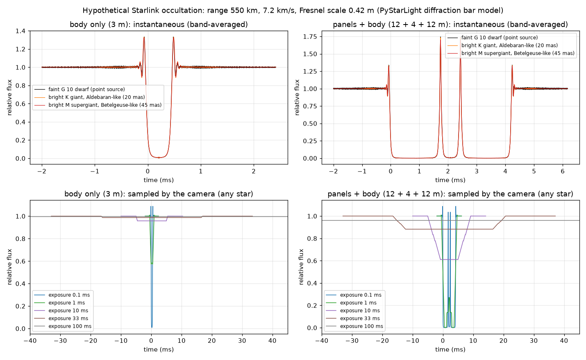

# What if a Starlink satellite occults a star?

A thought experiment with PyStarLight's diffraction model ([diffraction.md](diffraction.md)): a satellite in low
Earth orbit passes exactly in front of a star, as seen from the telescope. How deep is the drop, how long does it
last, does it matter whether the star is bright or faint, and what would a camera record?

The answer in short: **every star blinks out almost completely, for 0.4 ms (the body) to about 4 ms (with the
solar panels).** The star's brightness hardly changes the light curve. The camera's exposure time decides what is
seen, and a normal 30 fps video shows almost nothing.



*Top: the light at the telescope at each instant, averaged over the camera's band, for three stars. Bottom: the same
light curve averaged over an exposure (a running box: each point is one exposure centred on that time; a camera
picks single points of it, one per frame).*

## Why a satellite is so different from an asteroid

| | Main-belt asteroid | Starlink satellite |
|---|---|---|
| distance Z | ~2.3 au | ~550 km (zenith), up to ~1,500 km low in the sky |
| Fresnel scale sqrt(λZ/2) | ~0.3 km | **0.42 m** |
| shadow width | its diameter (km) | its size: **3 m to ~30 m** |
| shadow speed | 5–15 km/s | ~7 km/s (the orbital speed) |
| duration | seconds | **0.4–4 ms** |
| a 20 mas star projects to | ~35 km | **5 cm** |

At 550 km even the largest stars are points. A Betelgeuse-sized star (45 mas) projects to 12 cm, less than a third
of the Fresnel scale. The full diffraction pattern survives for every star: fringes at each edge, peaks up to
1.33 times the normal light, and bright spikes (up to 1.74) where light passes through the 1 m gaps between the
panels and the body. The Fresnel scale is crossed in about 60 µs.

## The model

`docs/starlink_occultation.py` computes the figure and the table below with `pystarlight.diffraction.transmission`:

- **Satellite**: opaque strips across the track (bar model), an illustrative Starlink V2-mini. Either the
  body only (a 3 m chord), or panel, body, panel (12 + 4 + 12 m with 1 m gaps, a 30 m chord). Real
  satellites vary with orientation, and the panels are thin plates seen at an angle.
- **Geometry**: slant range 550 km (satellite at the zenith), shadow speed 7.2 km/s across the track.
- **Camera band**: a rough unfiltered monochrome CMOS QE curve, weighted by the star's black-body photon
  spectrum (5800 K for the faint star, 3600 K for the giants).
- **Stars**: a faint G 10 dwarf (a point source), an Aldebaran-like K giant (20 mas) and a Betelgeuse-like M
  supergiant (45 mas), all limb-darkened (u = 0.6).
- **Exposure**: a box of 0.1 ms to 100 ms.

## Drop and duration

The light left at the deepest point (in brackets: the depth in magnitudes). It is the same for all three stars, to
within a few tenths of a percent:

| Camera samples | Body only (3 m, 0.42 ms) | Panels + body (30 m, 4.2 ms) |
|---|---|---|
| instantaneous | 0.2 % (fringe peaks 1.33) | 0.0 % (peaks 1.74 in the gaps) |
| 0.1 ms | 0.8 % (5.2 mag) | 0.1 % (7.8 mag) |
| 1 ms (kHz camera) | 57 % (0.61 mag) | 0.1 % (7.4 mag) |
| 10 ms | 96 % (0.05 mag) | 61 % (0.54 mag) |
| 33 ms (30 fps video) | 99 % (0.01 mag) | 88 % (0.14 mag) |
| 100 ms | 99.6 % (0.004 mag) | 96 % (0.04 mag) |

The light missing in total is always the geometric amount: 0.42 ms (body) or 3.9 ms (panels + body) of starlight.
A longer exposure only spreads that loss over more time.

## Bright star or faint star

- **The light curve: practically the same.** Size changes nothing that matters: the supergiant's fringe peak is
  1.325 instead of 1.334, and its bottom 0.6 % instead of 0.2 %.
- **What can be detected: very different.** A rough photon count for a 25 cm telescope (photon noise only):
  - a G 2 star loses about 25,000 photons in the 0.4 ms body event, plenty. At these time scales
    scintillation (~10 % per ms) is the real limit;
  - a G 10 star loses only about 17 photons (body) or 150 (panels + body): a signal-to-noise ratio of about 4
    or 12. That needs a photon-counting or very low-noise kHz detector, not a video camera;
  - G 13 and fainter: hopeless.

## In practice

- **A sunlit satellite adds its own light.** Seen in sunlight a Starlink is about magnitude 6–7. At 0.75°/s it
  crosses a 5″ photometry aperture in about 2 ms, exactly during the occultation. For a G 10 star that is about
  40 times more light than the star's, so the event shows as a flash, not a dip. For a G 2 star it adds only
  ~2.5 %. A clean dip needs a satellite in the Earth's shadow, late at night.
- **It cannot be predicted for a fixed telescope.** The shadow path is 3–30 m wide, while public orbital
  elements (TLEs) place a satellite only to about a kilometre.
- **It happens often.** With about 10,000 satellites in that shell, a given star near the zenith is crossed
  roughly every 4–12 days (satellite density times speed times width; more often near the shells' inclination
  latitudes and low in the sky). In a wide field with many stars that is all the time, but far too short for a
  normal video to notice.

So a 30 fps video would show at most a 0.01–0.14 mag dip in one frame. To see the drop, fringes and all, takes
sampling of about 0.1 ms.

To recompute it with other numbers (distance, speed, sizes, band), change the constants at the top of the script:

```
uv run python docs/starlink_occultation.py
```
